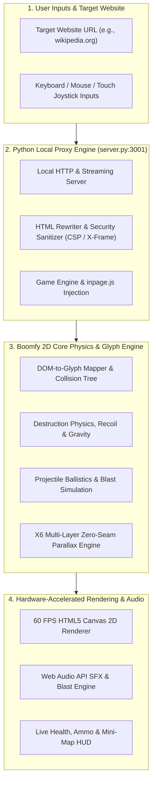

<div align="center">

# Boomfy — Arcade Browser Destruction & Stickman Physics Engine

<p align="center">
  <a href="README.tr.md">🇹🇷 Türkçe</a> • <b>🇺🇸 English</b>
</p>

<p align="center">
  <strong>Transform any website into a battleground: Real-time destruction physics, a legendary arsenal, and pixel parallax worlds.</strong><br>
  <em>Enter the URL of any website, convert the page into a 2D platform map, and blow up buildings, buttons, and headlines with your stickman fighter!</em>
</p>

<p align="center">
  <a href="LICENSE"></a>
  <a href="https://github.com/omerfys/Boomfy/stargazers"></a>
  <a href="https://www.python.org/"></a>
  <a href="https://developer.mozilla.org/en-US/docs/Web/API/Canvas_API"></a>
  
  
  
  
</p>

<br>

> **Boomfy** is a **next-generation interactive web destruction and stickman action game** powered by a local Python web proxy engine (`server.py`) and hardware-accelerated HTML5 Canvas 2D. Players can instantly transform any website (Wikipedia, news outlets, blogs, etc.) into breakable physics platforms, fly with jetpacks, battle with an arsenal ranging from railguns to tactical nuclear missiles, and immerse themselves in seamless 3-layer parallax backgrounds.

[Quick Start](#-quick-start--installation) • [Key Features](#-key-features) • [Website Destruction Guide](#-destroy-any-website-guide) • [Weapons Arsenal](#-weapons-arsenal--damage-chart) • [Battle Maps](#-thematic-battle-maps--destructible-arenas) • [Parallax Worlds](#-parallax-worlds--layers) • [Turkish Overview / Türkçe](#-turkish-overview-türkçe-özet)

<br>

<div align="center">
  
  <p align="center"><em>▲ Real-time stickman physics collision, sword fights, particle effects, and 60 FPS hardware-accelerated arena action</em></p>
</div>

---

</div>

## 📑 Table of Contents

- [Key Features](#-key-features)
- [Architecture & Working Principles](#-architecture--working-principles)
- [System Requirements](#-system-requirements)
- [Quick Start & Installation](#-quick-start--installation)
- [Destroy Any Website Guide](#-destroy-any-website-guide)
- [Weapons Arsenal & Damage Chart](#-weapons-arsenal--damage-chart)
- [Thematic Battle Maps & Destructible Arenas](#-thematic-battle-maps--destructible-arenas)
- [Characters, Classes & Skins](#-characters-classes--skins)
- [Parallax Worlds & Layers](#-parallax-worlds--layers)
- [Game Controls & Keybindings](#-game-controls--keybindings)
- [Local Server Architecture & Error Resilience](#-local-server-architecture--error-resilience)
- [Frequently Asked Questions (FAQ)](#-frequently-asked-questions-faq)
- [Turkish Overview (Türkçe Özet)](#-turkish-overview-türkçe-özet)
- [Keywords Index](#-keywords-index)
- [License & Author](#-license--author)

---

## ✨ Key Features

- **Destroy Any Website Proxy:** Enter any website URL in the address bar. The local proxy engine strips away security restrictions (CSP / X-Frame-Options) and converts DOM elements and live text into real-time breakable 2D platform glyphs.
- **Real-Time Physical Destruction & Debris Simulation:** Bullets, rockets, and explosions shatter website buttons, paragraphs, and images into hundreds of independent physics-driven particles.
- **Jetpack & Parachute Physics:** Defy gravity! Hold `Space` to soar through the sky with your jetpack, deploy a parachute when falling from heights for a controlled landing, or perform airborne backflips.
- **10 Legendary Weapons & Secondary Gear:** A massive arsenal spanning heavy pistols, the infinite-piercing Hyperion Railgun, autonomous tracking drone swarms, the black-hole-spawning Singularity Core, and the 12-submunition Cluster Nuke missile.
- **6 Custom Stickman Warrior Classes:** Classic Striker, Cyber Reaper, Inferno Oni, Astral Phantom, Blood Sovereign, and Solar Emperor; featuring custom headgear, crowns, and rank insignias.
- **3-Layer Zero-Seam Parallax Backgrounds:**
  - **Midnight City / Neo Cyber City:** Synthwave cyberpunk skyscrapers and glowing neon lights.
  - **Mystic Forest:** OpenGameArt CC0-licensed misty mountain ranges, pine forests, and turquoise sky (mathematical zero-seam vertical wrapping).
  - **Moonlit Samurai:** Full moon, Japanese pagoda temples, and cherry blossom ridges.
- **Resilient Python Server with HTTP 206 Streaming (`server.py`):** Serves chunked media streams, handles Windows socket disconnects (`WinError 10053/10054`) silently without crashing, and acts as an unblockable local proxy.
- **Web Audio API Sound & Reverb Engine:** Weapon kicks, deep explosion bass, jetpack humming, and retro chiptune effects.
- **Dual-Mode Controls:** Full Keyboard + Mouse desktop controls along with virtual analog touch joysticks for touchscreen devices.

---

## 🏛️ Architecture & Working Principles

Boomfy integrates a local Python proxy layer, an HTML rewriter, a DOM glyph collision engine, and a hardware-accelerated 2D canvas renderer into a unified architecture:



---

## 📋 System Requirements

- **Operating System:** Windows 10 / 11, macOS, or Linux
- **Python Version:** Python 3.10 or higher ([Download Python](https://www.python.org/downloads/))
- **Browser:** Google Chrome, Microsoft Edge, Mozilla Firefox, Opera, or Brave (Any modern browser with Canvas 2D support)
- **External Packages / Dependencies:** **ZERO (Zero External PIP Dependency)** — Runs entirely on Python standard library modules!

---

## 🚀 Quick Start & Installation

### 1. Download / Clone the Repository
```bash
git clone https://github.com/omerfys/Boomfy.git
cd Boomfy
```

### 2. One-Click Launch (Windows)
Double-click the **`start.bat`** file located in the folder. It will launch the server automatically and direct your browser straight into the game.

### 3. Alternative: Launch via Terminal
```bash
python server.py
```
Once the server has started, navigate to this address in your browser:
```text
http://localhost:3001/
```

---

## 🌐 Destroy Any Website Guide

Boomfy's greatest strength is its ability to convert any live web page on the internet into an interactive combat platform:

<div align="center">
  
  <p align="center"><em>▲ Converting any website (Wikipedia, etc.) into breakable physics platforms and particle glyphs via local proxy</em></p>
</div>

1. Open the game and type the address of your desired website into the search bar on the home screen:
   - Example: `en.wikipedia.org/wiki/Stick_figure`
   - Example: `news.ycombinator.com`
   - Example: `github.com`
2. Click the **"Destroy"** button or press `Enter`.
3. The server immediately fetches the site through the local proxy and transforms all text blocks, buttons, and headings into solid ground glyphs.
4. Your character parachutes down from the top of the page, and you can immediately begin tearing the website apart with your weapons!

---

## 🔫 Weapons Arsenal & Damage Chart

<div align="center">
  
  <p align="center"><em>▲ 10 Primary weapons, tactical secondary gear (Jetpack, Parachute, HE Grenade), and projectile ballistics</em></p>
</div>

Technical parameters of the 10 primary weapons and tactical secondary equipment:

| Weapon Name | Type / Projectile | Single Mag Damage | Bullet Speed | Recoil (Kick) | Knockback (Push) | Special Attribute |
| :--- | :--- | :--- | :--- | :--- | :--- | :--- |
| **Heavy Magnum** | Heavy Pistol | 32 HP | 3400 px/s | 5.5 | 40 | High penetration (8 pierce), rapid semi-auto fire |
| **Hyper Vector** | Submachine Gun | 14 HP | 2900 px/s | 2.2 | 22 | Fully automatic ultra-high fire rate (0.048s cooldown) |
| **Combat Sweeper** | Shotgun | 14 × 16 HP | 2500 px/s | 8.5 | 320 | 14 pellets per shot, massive knockback impulse |
| **Titan RPG** | Rocket Launcher | Splash Damage | 680 px/s | 7.0 | 180 | Explosive rocket that shatters walls and terrain glyphs |
| **Hyperion Railgun** | Railgun | **190 HP** | Instant Beam | **11.0** | 340 | **Infinite penetration (999 pierce)**, map-piercing laser beam |
| **Dragon Firestorm** | Flamethrower | Continuous Flame | 750 px/s | 0.6 | 0 | 8-particle incendiary jet, flushes out cover |
| **Cluster MIRV Nuke** | Tactical Nuke | Massive AoE | 880 px/s | 12.0 | 360 | Scatters 12 cluster warheads across the arena on impact |
| **Apex Drone Swarm** | Autonomous Drone | 22 HP | 3200 px/s | 1.5 | 0 | Micro drone swarm homing directly into targets |
| **Singularity Core** | Black Hole | Gravity Well | 680 px/s | 10.0 | 180 | Gravitational core pulling particles and enemies inward |
| **Celestial Arcana** | Magic Staff | Energy Orb | 680 px/s | 2.5 | 0 | Bouncing magic barrage melting surfaces on contact |

### 💣 Secondary Gear:
- **HE Grenade (Right-Click):** High-explosive grenade with a 1.3-second timed fuse and a 65-unit blast radius.
- **Jetpack:** Rocket thruster backpack providing sustained vertical thrust when holding `Space`.
- **Parachute:** Tactical air chute enabling smooth glides and controlled vertical drops.

---

## 🗺️ Thematic Battle Maps & Destructible Arenas

In addition to external websites, Boomfy features pre-built thematic arenas crafted entirely from breakable structures:

<div align="center">
  
  <p align="center"><em>▲ Pre-built thematic arenas built with breakable blocks and text platforms (Pirate Cove, Rooftops Battle, Toybox Chaos)</em></p>
</div>

- **Pirate Cove:** Wooden pirate galleons, tall masts, treasure vaults, and dynamic explosive pits.
- **Rooftops Battle:** High-rise skyscraper rooftops, Eiffel Tower girders, and airborne skirmishes on narrow bridges.
- **Toybox Chaos:** Bouncing toy blocks, vibrant letter towers, and high-elasticity collision surfaces.
- **Ruinhold:** Ancient stone ruins, subterranean crypts, and hidden passage corridors.

---

## 🥷 Characters, Classes & Skins

Players can equip 6 distinct stickman warrior classes based on their level and tactical preferences:

| Character ID | Display Name | Rank Tier | Visual Theme & Details |
| :--- | :--- | :--- | :--- |
| `stickman` | **Classic Striker** | Rank 1 | Iconic black-line stickman fighter with balanced movement physics |
| `skeleton` | **Cyber Reaper** | Rank 2 | Cybernetic skeleton frame, glowing cyber optics, and metallic bones |
| `pumpkin` | **Inferno Oni** | Rank 3 | Flaming-eyed pumpkin helm, molten lava particle aura |
| `will` | **Astral Phantom** | Rank 4 | Mystic cosmic spirit, translucent spectral form, and celestial energy |
| `vampire` | **Blood Sovereign** | Rank 5 | Noble blood lord with a dark crimson cape and gothic contours |
| `crown` | **Solar Emperor** | Rank 6 | Golden royal crown, radiant solar energy, and supreme sovereign aura |

---

## 🌄 Parallax Worlds & Layers

All background environments in Boomfy utilize **mathematical zero-seam (`make_seamless_pure`)** layers that eliminate any vertical tiling artifacts or repetitive seams on ultra-wide monitors:

<div align="center">
  
  <p align="center"><em>▲ Dynamic 3-layer parallax depth engine with mathematical zero-seam wrapping</em></p>
</div>

```text
┌────────────────────────────────────────────────────────────────────────┐
│                        BOOMFY PARALLAX WORLDS                          │
├───────────────────┬──────────────┬───────────────┬─────────────────────┤
│ Theme Name        │ ID           │ Layer Count   │ Speed Coefficients  │
├───────────────────┼──────────────┼───────────────┼─────────────────────┤
│ 🌆 Midnight City   │ cities       │ 3 Layers      │ 0.02 / 0.06 / 0.12  │
│ 🌲 Mystic Forest   │ mountain     │ 3 Layers      │ 0.01 / 0.04 / 0.09  │
│ 🌙 Moonlit Samurai │ sunny        │ 3 Layers      │ 0.01 / 0.05 / 0.10  │
└───────────────────┴──────────────┴───────────────┴─────────────────────┘
```

- **Mystic Forest (Latest World):** Generated from authentic OpenGameArt CC0 pixel art. The sky and sun layer slowly drift in the furthest background (`0.01`), a triple-tier green mountain range glides in the midground (`0.04`), while pine trees and rocky foregrounds (`0.09`) create a deep sense of spatial dimension.
- **Zero-Seam Guarantee:** Cosine-weighted edge blending between horizontal borders ensures that no vertical line or artificial repetition appears, regardless of resolution.

---

## ⌨️ Game Controls & Keybindings

| Key / Input | Action |
| :--- | :--- |
| `W` / `Up Arrow` | Jump / Climb |
| `A` - `D` / `Left - Right Arrow` | Run Left and Right / Accelerate |
| `S` / `Down Arrow` | Drop through platforms / Crouch |
| `Space - Hold` | **Fire Jetpack** (Ascend and fly vertically) |
| `Space - Double Tap` | Perform an acrobatic aerial **Backflip** |
| `Mouse Left Click` | Fire primary equipped weapon |
| `Mouse Right Click` | **Throw HE Grenade** |
| `Mouse Movement (Aim)` | 360-degree aiming and targeting |
| `ESC Key` | Pause, switch background theme, and open settings menu |

---

## ⚡ Local Server Architecture & Error Resilience

The core engine [`server.py`](file:///D:/ProjectX/Boomfy/server.py) is far more than a basic HTTP server:

1. **Client Disconnect Protection (`is_client_disconnect`):** Silently intercepts Windows socket termination errors (`WinError 10053`, `WinError 10054`, `BrokenPipeError`) when the browser refreshes or closes tabs, keeping the console log clean and preventing process crashes.
2. **HTTP 206 Partial Content (Streaming Media Support):** Streams large media files such as `assets/video/title.mp4` in 64 KB chunks rather than loading them entirely into memory, keeping browser overhead virtually at zero.
3. **CORS & Security Policy Bypass:** Strips out `X-Frame-Options` and `Content-Security-Policy` headers from target websites, enabling the game engine to render and interact with pages without browser restrictions.
4. **Comprehensive MIME Type Registry:** Maps and serves modern web game assets (`.gz`, `.bin`, `.woff2`, `.flac`) with accurate headers.

---

## ❓ Frequently Asked Questions (FAQ)

<details>
<summary><strong>1. What should I do if I encounter a "Port 3001 already in use" error?</strong></summary>
An older server process may still be running in the background. You can terminate any orphan Python processes via Task Manager or relaunch the server through the terminal:
```bash
python server.py
```
</details>

<details>
<summary><strong>2. Can I transform literally any website into a map?</strong></summary>
Yes! Almost any public static or dynamic website (Wikipedia, news aggregators, documentation hubs, etc.) can be converted into a destructible battleground. For heavily protected websites, make sure to prefix the URL with <code>https://</code>.
</details>

<details>
<summary><strong>3. How do I switch backgrounds during gameplay?</strong></summary>
Press <code>ESC</code> on your keyboard while in-game. From the menu overlay, you can select any background (<strong>Midnight City</strong>, <strong>Mystic Forest</strong>, or <strong>Moonlit Samurai</strong>) with a single click. Your preference is preserved in browser storage.
</details>

<details>
<summary><strong>4. Can I run the game without installing external packages?</strong></summary>
Absolutely! The project has zero external dependencies on <code>npm</code>, <code>pip</code>, or third-party packages. A standard Python installation and a modern web browser are all you need.
</details>

---

## 🇹🇷 Turkish Overview (Türkçe Özet)

**Boomfy**, yerel bir Python proxy sunucusu (`server.py`) ve donanım hızlandırmalı HTML5 Canvas 2D üzerinde çalışan, sıfır harici paket bağımlılığına sahip web tabanlı bir imha ve arcade platform oyunudur. Dilediğiniz web sitesinin URL adresini girerek sayfayı anında 2D savaş arenasına ve parçalanabilir gliflere dönüştürebilirsiniz! Detaylı Türkçe dokümantasyon ve rehber için **[README.tr.md](README.tr.md)** dosyasını inceleyebilirsiniz.

---

## 🔍 Keywords Index

This repository is optimized for the following search terms and keywords:

`boomfy` • `destroy any website game` • `internet sitelerini yok etme oyunu` • `web page destruction game` • `stickman shooter browser game` • `html5 canvas 2d physics` • `web proxy arcade platformer` • `interactive web page destroyer` • `canvas destruction engine` • `parallax pixel art backgrounds` • `mystic forest parallax` • `hyperion railgun game` • `python browser game proxy` • `zero dependency browser game` • `creative coding game engine` • `omerfy boomfy`

---

## 📜 License & Author

This project is licensed under the **MIT License**. See the [LICENSE](LICENSE) file for more details.

Developer: **[@omerfys](https://github.com/omerfys)**  
GitHub Repository: [https://github.com/omerfys/Boomfy](https://github.com/omerfys/Boomfy)

⭐ **If you enjoyed this project, don't forget to give it a star on GitHub!**
