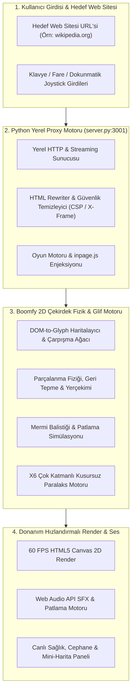

<div align="center">

# 💥 Boomfy — Arcade Browser Destruction & Stickman Physics Engine

<p align="center">
  <strong>İnternet sitelerini savaş alanına dönüştürün: Gerçek zamanlı parçalanma fiziği, efsanevi silah cephaneliği ve piksel paralaks dünyaları.</strong><br>
  <em>Dilediğiniz web sitesinin URL'sini girin, sayfayı 2D platform haritasına çevirin ve stickman karakterinizle binaları, butonları ve başlıkları havaya uçurun!</em>
</p>

[](https://github.com/omerfys/Boomfy)
[](https://github.com/omerfys/Boomfy)
[](https://www.python.org/)
[](https://developer.mozilla.org/en-US/docs/Web/API/Canvas_API)
[](https://github.com/omerfys/Boomfy)
[](https://github.com/omerfys/Boomfy)
[](https://github.com/omerfys/Boomfy)
[](LICENSE)

<br><br>

> 💥 **Boomfy** & **Destroy Any Website Arcade Game**: Yerel Python web proxy motoru (`server.py`) ve donanım hızlandırmalı HTML5 Canvas 2D üzerinde çalışan; oyuncuların istedikleri herhangi bir web sitesini (Wikipedia, haber siteleri, bloglar vb.) anında kırılabilir fizik platformlarına dönüştürdüğü, jetpack ile uçup raylı tüfeklerden taktiksel nükleer füzelere uzanan cephanelikle savaştığı, sıfır dikişli 3 katmanlı paralaks arka planlara sahip **yeni nesil interaktif web imha ve stickman aksiyon oyunu**.

[Hızlı Başlangıç](#-hızlı-başlangıç--kurulum) • [Öne Çıkan Özellikler](#-öne-çıkan-özellikler) • [Sistem Mimarisi](#-mimari--çalışma-prensibi) • [Silah Cephaneliği](#-silah-cephaneliği--hasar-tablosu) • [Karakterler & Kostümler](#-karakterler-sınıflar--görünümler) • [Paralaks Dünyaları](#-paralaks-dünyaları--katmanlar) • [Web Sitesi Yıkım Rehberi](#-herhangi-bir-web-sitesini-haritaya-dönüştürme-rehberi) • [English Overview](#-english-overview-boomfy-arcade-browser-destruction-engine) • [SEO İndeksi](#-arama-terimleri--keywords-index)

---

</div>

## 📑 İçindekiler
- [Öne Çıkan Özellikler](#-öne-çıkan-özellikler)
- [Mimari & Çalışma Prensibi](#-mimari--çalışma-prensibi)
- [Sistem Gereksinimleri](#-sistem-gereksinimleri)
- [Hızlı Başlangıç & Kurulum](#-hızlı-başlangıç--kurulum)
- [Herhangi Bir Web Sitesini Haritaya Dönüştürme Rehberi](#-herhangi-bir-web-sitesini-haritaya-dönüştürme-rehberi)
- [Silah Cephaneliği & Hasar Tablosu](#-silah-cephaneliği--hasar-tablosu)
- [Karakterler, Sınıflar & Görünümler](#-karakterler-sınıflar--görünümler)
- [Paralaks Dünyaları & Katmanlar](#-paralaks-dünyaları--katmanlar)
- [Oyun Kontrolleri & Tuş Kombinasyonları](#-oyun-kontrolleri--tuş-kombinasyonları)
- [Yerel Sunucu Mimarisi & Hata Koruması](#-yerel-sunucu-mimarisi--hata-koruması)
- [Sıkça Sorulan Sorular (FAQ)](#-sıkça-sorulan-sorular-faq)
- [English Overview: Boomfy Arcade Browser Destruction Engine](#-english-overview-boomfy-arcade-browser-destruction-engine)
- [Arama Terimleri / Keywords Index](#-arama-terimleri--keywords-index)
- [Lisans & Yazar](#-lisans--yazar)

---

## ✨ Öne Çıkan Özellikler

- 🌐 **İnternet Sayfalarını Haritaya Dönüştürme (Destroy Any Website Proxy):** Dilediğiniz web sitesinin URL adresini arama çubuğuna yazın. Yerel proxy motoru sayfayı güvenlik kısıtlamalarından (CSP / X-Frame-Options) arındırır, DOM elementlerini ve metinleri gerçek zamanlı parçalanabilir 2D platform gliflerine dönüştürür.
- 💥 **Gerçek Zamanlı Fiziksel İmha & Enkaz Simülasyonu:** Mermiler, roketler ve patlamalar web sayfalarındaki butonları, paragrafları ve resimleri fizik kurallarına uygun olarak yüzlerce bağımsız parçacığa böler.
- 🚀 **Jetpack & Paraşüt Fiziği:** Yerçekimine meydan okuyun! `Space` tuşuna basılı tutarak jetpack ile gökyüzüne uçun, yüksekten düşerken paraşüt açarak yumuşak iniş yapın veya havada çift takla atın.
- 🔫 **10 Efsanevi Silah & İkincil Ekipmanlar:** Ağır tabancalardan sınırsız delen Hyperion Raylı Tüfeğe, düşmanı takip eden otonom dronlardan kara delik açan Singularity Çekirdeğine ve 12 parçaya bölünen Cluster Nükleer füzeye kadar zengin bir cephanelik.
- 🥷 **6 Özel Stickman Savaşçı Sınıfı:** Classic Striker, Cyber Reaper, Inferno Oni, Astral Phantom, Blood Sovereign ve Solar Emperor; özel kafa zırhları, taçlar ve seviye rozetleri.
- 🌄 **3 Katmanlı Kusursuz Paralaks Arka Planlar:**
  - 🌆 **Midnight City / Neo Cyber City:** Synthwave cyberpunk gökdelenler ve neon ışıklar.
  - 🌲 **Mystic Forest:** OpenGameArt CC0 lisanslı sisli yeşil sıradağlar, çam ormanı ve turkuaz gökyüzü (sıfır dikiş dikey çizgisiz döngü).
  - 🌙 **Moonlit Samurai:** Dolunay, Japon pagoda tapınakları ve kiraz çiçeği dağları.
- ⚡ **HTTP 206 Streaming Destekli Dayanıklı Python Sunucusu (`server.py`):** Video/medya dosyalarını parça parça akıtan, Windows soket kopmalarını (`WinError 10053/10054`) sessizce yöneten ve çökmeyen yerel proxy motoru.
- 🎵 **Web Audio API Ses & Yankı Sistemi:** Silah geri tepmeleri, patlama basları, jetpack vızıltısı ve retro çip sesleri.
- 🎮 **Çift Mod Kontrol:** Klavye + Fare masaüstü kontrollerinin yanı sıra dokunmatik ekranlar için sanal analog joystick desteği.

---

## 🏛️ Mimari & Çalışma Prensibi

Boomfy; yerel Python proxy katmanı, HTML yeniden yazıcı (rewriter), DOM glif çarpışma motoru ve donanım hızlandırmalı 2D canvas görselleştiricisini entegre bir yapıda sunar:



---

## 📋 Sistem Gereksinimleri

- **İşletim Sistemi:** Windows 10 / 11, macOS veya Linux
- **Python Sürümü:** Python 3.10 veya üzeri ([Python İndir](https://www.python.org/downloads/))
- **Tarayıcı:** Google Chrome, Microsoft Edge, Mozilla Firefox, Opera veya Brave (Modern Canvas 2D destekli herhangi bir tarayıcı)
- **Ek Paket / Bağımlılık:** **SIFIR (Zero External PIP Dependency)** — Yalnızca Python standart kütüphaneleriyle çalışır!

---

## 🚀 Hızlı Başlangıç & Kurulum

### 1. Depoyu İndirin / Klonlayın
```bash
git clone https://github.com/omerfys/Boomfy.git
cd Boomfy
```

### 2. Tek Tıkla Başlatın (Windows)
Klasör içindeki **`start.bat`** dosyasına çift tıklayın. Sunucuyu otomatik başlatır ve tarayıcınızı doğrudan oyuna yönlendirir.

### 3. Alternatif: Terminal Üzerinden Başlatma
```bash
python server.py
```
Sunucu başladığında tarayıcınızdan şu adrese gidin:
```text
http://localhost:3001/
```

---

## 🌐 Herhangi Bir Web Sitesini Haritaya Dönüştürme Rehberi

Boomfy'nin en büyük gücü, internetteki her web sayfasını interaktif bir savaş platformuna çevirebilmesidir:

1. Oyunu açtıktan sonra ana ekrandaki arama çubuğuna dilediğiniz sitenin adresini yazın:
   - Örnek: `en.wikipedia.org/wiki/Stick_figure`
   - Örnek: `news.ycombinator.com`
   - Örnek: `github.com`
2. **"Yok Et / Destroy"** butonuna tıklayın veya `Enter` tuşuna basın.
3. Sunucu siteyi anında proxy üzerinden çeker, sayfadaki tüm metin bloklarını ve başlıkları sert zemin gliflerine dönüştürür.
4. Karakteriniz sayfanın tepesinden paraşütle iner ve sayfayı mermilerinizle parça parça yok etmeye başlayabilirsiniz!

---

## 🔫 Silah Cephaneliği & Hasar Tablosu

Oyunda bulunan 10 ana silah ve ikincil taktiksel teçhizatların teknik parametreleri:

| Silah Adı | Tür / Mermi | Tek Şarjör Hasarı | Mermi Hızı | Geri Tepme (Kick) | İtme (Push) | Özel Nitelik |
| :--- | :--- | :--- | :--- | :--- | :--- | :--- |
| **Heavy Magnum** | Ağır Tabanca | 32 HP | 3400 px/s | 5.5 | 40 | Yüksek delme (8 pierce), hızlı tekli atış |
| **Hyper Vector** | Hafif Makineli | 14 HP | 2900 px/s | 2.2 | 22 | Tam otomatik ultra seri atış (0.048s cooldown) |
| **Combat Sweeper** | Pompalı Tüfek | 14 × 16 HP | 2500 px/s | 8.5 | 320 | Tek atışta 14 saçma, devasa geri itme kuvveti |
| **Titan RPG** | Roketatar | Alan Hasarı | 680 px/s | 7.0 | 180 | Duvarları ve glifleri paramparça eden patlayıcı roket |
| **Hyperion Railgun** | Raylı Tüfek | **190 HP** | Anlık Işın | **11.0** | 340 | **Sınırsız delme (999 pierce)**, tüm haritayı delip geçen ışın |
| **Dragon Firestorm** | Alev Silahı | Sürekli Alev | 750 px/s | 0.6 | 0 | 8 parçacıklı yangın jeti, siper arkasını temizler |
| **Cluster MIRV Nuke** | Taktiksel Nükleer | Devasa Alan | 880 px/s | 12.0 | 360 | Patlama anında etrafa 12 adet Cluster bombası saçar |
| **Apex Drone Swarm** | Otonom Dron | 22 HP | 3200 px/s | 1.5 | 0 | Hedefe yönelen güdümlü mikro dron filosu |
| **Singularity Core** | Kara Delik | Çekim Alanı | 680 px/s | 10.0 | 180 | Haritadaki parçacıkları ve düşmanları içine çeken çekirdek |
| **Celestial Arcana** | Büyü Asası | Enerji Küresi | 680 px/s | 2.5 | 0 | Seken ve temas ettiği yüzeyi eriten büyü salvosu |

### 💣 İkincil Ekipmanlar:
- **HE Grenade (Sağ Tık):** 1.3 saniyelik gecikmeli fitile ve 65 birim etki yarıçapına sahip yüksek patlayıcılı el bombası.
- **Jetpack:** `Space` tuşuna basılı tutulduğunda dikey ivme sağlayan roket sırt çantası.
- **Paraşüt:** Boşlukta süzülmeyi ve kontrollü inişi sağlayan taktiksel hava yelkeni.

---

## 🥷 Karakterler, Sınıflar & Görünümler

Oyuncular oyun içi seviyelerine ve tercihlerine göre 6 farklı stickman savaşçı görünümünü kuşanabilir:

| Karakter ID | Görünen Adı | Rütbe Seviyesi | Görsel Tema & Detaylar |
| :--- | :--- | :--- | :--- |
| `stickman` | **Classic Striker** | Rank 1 | Klasik siyah çizgi stickman savaşçısı, dengeli hareket fiziği |
| `skeleton` | **Cyber Reaper** | Rank 2 | Siber iskelet gövde, parlak siber optikler ve metalik kemikler |
| `pumpkin` | **Inferno Oni** | Rank 3 | Alev gözlü bal kabağı zırhı, lav rengi parçacık aurası |
| `will` | **Astral Phantom** | Rank 4 | Mistik kozmik ruh, yarı saydam hayalet formu ve göksel enerji |
| `vampire` | **Blood Sovereign** | Rank 5 | Soylu kan lordu, koyu kırmızı pelerin ve gotik karanlık hatlar |
| `crown` | **Solar Emperor** | Rank 6 | Altın kraliyet tacı, parıldayan sarı enerji ve lider aurası |

---

## 🌄 Paralaks Dünyaları & Katmanlar

Boomfy'deki tüm arka planlar, geniş monitörlerde ve harita kaydırmalarında dikey çizgi veya tekrar hissi oluşturmayan **matematiksel sıfır dikişli (`make_seamless_pure`)** katmanlardan oluşur:

```text
┌────────────────────────────────────────────────────────────────────────┐
│                      BOOMFY PARALAKS DÜNYALARI                         │
├───────────────────┬──────────────┬───────────────┬─────────────────────┤
│ Tema Adı          │ ID           │ Katman Sayısı │ Hız Katsayıları     │
├───────────────────┼──────────────┼───────────────┼─────────────────────┤
│ 🌆 Midnight City   │ cities       │ 3 Katman      │ 0.02 / 0.06 / 0.12  │
│ 🌲 Mystic Forest   │ mountain     │ 3 Katman      │ 0.01 / 0.04 / 0.09  │
│ 🌙 Moonlit Samurai │ sunny        │ 3 Katman      │ 0.01 / 0.05 / 0.10  │
└───────────────────┴──────────────┴───────────────┴─────────────────────┘
```

- **🌲 Mystic Forest (En Yeni Dünya):** OpenGameArt CC0 lisanslı orijinal piksel sanatından üretilmiştir. Gökyüzü ve güneş katmanı en uzakta yavaşça kayarken (`0.01`), üç kademeli yeşil dağ silsilesi orta planda süzülür (`0.04`), çam ağaçları ve zemin kayalıkları ise kameraya en yakın planda (`0.09`) derinlik hissi yaratır.
- **Sıfır Dikiş Garantisi:** Sağ ve sol kenarlar arasındaki kosinüs harmanlaması sayesinde ekran ne kadar geniş olursa olsun hiçbir dikey çizgi veya yapay tekrar görünmez.

---

## ⌨️ Oyun Kontrolleri & Tuş Kombinasyonları

| Tuş / Girdi | Fonksiyon |
| :--- | :--- |
| `W` / `Yukarı Ok` | Zıplama / Tırmanma |
| `A` - `D` / `Sol - Sağ Ok` | Sağa ve sola koşma / Hızlanma |
| `S` / `Aşağı Ok` | Platformdan aşağı inme / Eğilme |
| `Space (Boşluk) - Basılı Tut` | **Jetpack Ateşleme** (Havada yükselme ve uçuş) |
| `Space - Çift Tıklama` | Havada akrobatik ters takla (**Backflip**) |
| `Sol Tık (Mouse Left)` | Seçili birincil silahı ateşleme |
| `Sağ Tık (Mouse Right)` | **HE El Bombası fırlatma** |
| `Fare Hareketi (Aim)` | 360 derece nişan alma ve yön tayini |
| `ESC Tuşu` | Duraklatma, arka plan değiştirme ve ayarlar menüsü |

---

## ⚡ Yerel Sunucu Mimarisi & Hata Koruması

Projenin kalbi olan [`server.py`](file:///c:/Users/omerfy/Desktop/Boomfy/server.py), sıradan bir HTTP sunucusundan çok daha fazlasıdır:

1. **İstemci Bağlantı İptali Koruması (`is_client_disconnect`):** Tarayıcı sayfayı yenilediğinde veya sekmeyi kapattığında oluşan Windows soket kesintilerini (`WinError 10053`, `WinError 10054`, `BrokenPipeError`) sessizce yakalar; konsolu kirlilikten ve çökmelerden korur.
2. **HTTP 206 Partial Content (Streaming Media Desteği):** `assets/video/title.mp4` gibi büyük medya dosyalarını tek seferde yüklemek yerine 64 KB'lık parçalar halinde akıtarak tarayıcı bellek yükünü sıfıra indirir.
3. **CORS & Güvenlik Politikası Atlatıcı:** Hedef web sitelerindeki `X-Frame-Options` ve `Content-Security-Policy` başlıklarını filtreleyerek oyun motorunun sayfayı engelsiz render etmesini sağlar.
4. **Gelişmiş MIME Türü Kaydı:** `.gz`, `.bin`, `.woff2`, `.flac` gibi tüm modern oyun varlıklarını doğru başlıklarla iletir.

---

## ❓ Sıkça Sorulan Sorular (FAQ)

### S: Port 3001 meşgul hatası alırsam ne yapmalıyım?
> **C:** Bilgisayarınızda arka planda açık kalmış eski bir sunucu süreci olabilir. Görev Yöneticisi'nden çalışan Python süreçlerini sonlandırabilir veya terminal üzerinden sunucuyu yeniden başlatabilirsiniz:
> ```bash
> python server.py
> ```

### S: İstediğim her web sitesini haritaya çevirebilir miyim?
> **C:** Evet! Statik veya dinamik neredeyse tüm halka açık web sitelerini (Wikipedia, haber portalları, dokümantasyon sayfaları vb.) yok edilebilir bir platforma dönüştürebilirsiniz. Bazı aşırı korumalı siteler için sayfa URL'sinin başına `https://` eklemeyi unutmayın.

### S: Arka planı oyun sırasında nasıl değiştirebilirim?
> **C:** Oyun ekranındayken klavyenizden `ESC` tuşuna basın. Açılan menüden dilediğiniz arka planı (**Midnight City**, **Mystic Forest** veya **Moonlit Samurai**) tek tıkla seçebilirsiniz. Seçiminiz tarayıcı önbelleğinde saklanır.

### S: Oyunu harici paket yüklemeden çalıştırabilir miyim?
> **C:** Kesinlikle evet! Projede `npm`, `pip` veya herhangi bir üçüncü parti kütüphane bağımlılığı yoktur. Yalnızca standart Python kurulumu ve modern bir web tarayıcısı yeterlidir.

---

## 🌍 English Overview: Boomfy Arcade Browser Destruction Engine

**Boomfy** is an exhilarating, zero-dependency browser-based arcade destruction platformer powered by a local Python proxy server (`server.py`) and hardware-accelerated HTML5 Canvas 2D. Enter any website URL to instantly transform live web pages into fully destructible 2D battle arenas!

### Key Highlights:
- 🌐 **Destroy Any Website Proxy:** Strips CSP restrictions and converts real-time DOM elements, headers, and images into destructible terrain glyphs.
- 💥 **Dynamic Debris & Disintegration Physics:** High-impact weapon projectiles tear apart website elements into hundreds of interactive physics particles.
- 🔫 **10 Devastating Weapons:** From the infinite-piercing *Hyperion Railgun* (190 DMG) to the screen-clearing *Cluster MIRV Nuke* and *Singularity Core*.
- 🥷 **6 Unique Stickman Classes:** Customizable fighter skins featuring *Cyber Reaper*, *Inferno Oni*, *Astral Phantom*, *Blood Sovereign*, and *Solar Emperor*.
- 🌄 **3 Zero-Seam Parallax Worlds:** Mathematical zero-boundary wrapping across *Midnight City*, *Mystic Forest*, and *Moonlit Samurai*.
- ⚡ **Resilient Python Server:** Built-in HTTP 206 Partial Content media streaming and WinError 10053/10054 client disconnect resilience.
- 🎮 **Universal Controls:** Seamless keyboard/mouse aiming alongside virtual touch dual-joystick controls for mobile.

---

## 🔍 Arama Terimleri / Keywords Index

Bu repo aşağıdaki arama terimleri ve anahtar kelimeler için optimize edilmiştir:

- `boomfy`
- `destroy any website game`
- `internet sitelerini yok etme oyunu`
- `web page destruction game`
- `stickman shooter browser game`
- `html5 canvas 2d physics`
- `web proxy arcade platformer`
- `interactive web page destroyer`
- `canvas destruction engine`
- `parallax pixel art backgrounds`
- `mystic forest parallax`
- `hyperion railgun game`
- `python browser game proxy`
- `zero dependency browser game`
- `creative coding game engine`
- `omerfy boomfy`

---

## 📜 Lisans & Yazar

Bu proje **MIT Lisansı** altında lisanslanmıştır. Detaylar için [LICENSE](LICENSE) dosyasına göz atabilirsiniz.

<br>

<div align="center">
  <sub>Geliştirici: <b><a href="https://github.com/omerfys">omerfy</a></b> • Web Oyunları ve Yaratıcı Kodlama Topluluğu İçin Sevgiyle Geliştirildi 💥</sub>
</div>
